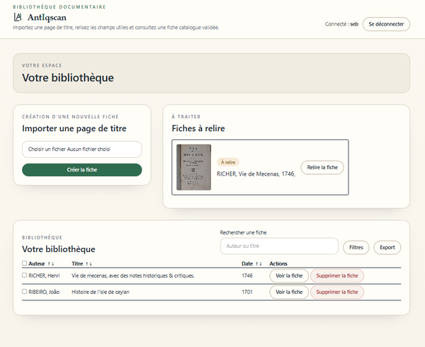
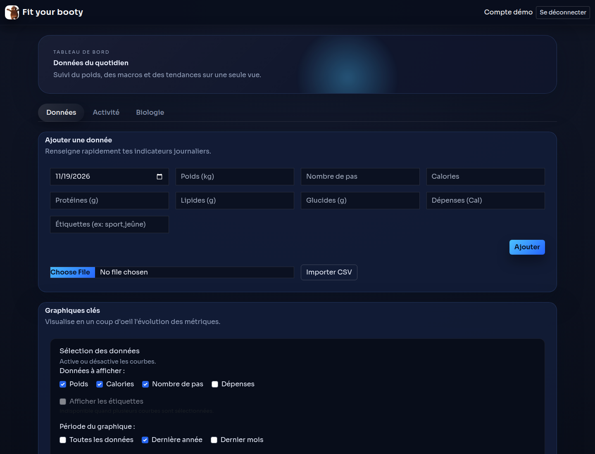

<h1 align="center">Sébastien Vatinel</h1>

<h3 align="center">Analytics Engineer</h3>

  SQL · Python · Power BI · Modélisation · Qualité des données

  
  

## À propos

🔬 Docteur en Sciences ·💲Entrepreneur e-commerce  · 📊Data Analyst en construction
 
Mon parcours est atypique et transversal
 
Après un doctorat en biologie/biotechnologie, 10 ans d'entrepreneuriat et gestion e-commerce (Wordpress, WooCommerce, marketplaces, SEO/SEA), je me reconvertis vers les métiers de la Data, là où convergent naturellement toutes mes compétences.

 
- Formation **Architecte en Intelligence Artificielle** — Jedha, certification RNCP niveau 7 en cours
- Expérience en gestion de catalogues, qualité des données, SEO et pilotage e-commerce
- Projets personnels déployés en production sur VPS Linux
- Basé près de Pau — télétravail ou présentiel

## Compétences

**Data & Analytics**  
SQL · Python · Pandas · Power BI · DAX · Excel · Google Sheets

**Structuration et qualité**  
Modélisation de données · Nettoyage · Contrôles de cohérence · Documentation · Reporting

**Automatisation IA**  
Harness Hermes Agent [Mon agent Alf] · worklow vibe coding · Codex

**Connaissance métier**  
E-commerce · Catalogues produits · Marketplaces · SEO · CRM · Workflows assistés par IA

## Projets sélectionnés

### [AntIqscan](https://github.com/SebV-code/antiqscan)

Application d’assistance au catalogage de livres anciens à partir d’une photographie de page de titre.

  

- extraction par IA limitée aux informations visibles ;
- validation humaine avant tout enrichissement ;
- sources, niveau de confiance et corrections conservés ;
- génération et export de fiches de catalogue.

**Stack :** Laravel · PHP · MySQL · Blade · Tailwind · IA vision · Caddy  

### [FitYourBooty](https://github.com/SebV-code/FitYourBooty)

Application web de collecte et de visualisation de données fitness, conçue pour suivre les mesures, les objectifs et leur évolution dans le temps.

  

- saisie et historisation des données ;
- tableaux et visualisations interactives ;
- suivi d’objectifs individuels ;
- déploiement et maintenance sur VPS Linux.

**Stack :** Laravel · PHP · MySQL · JavaScript · Plotly · Linux  

## En ce moment

Je consolide mon positionnement en **Analytics Engineering** autour de SQL, Python, la modélisation, la qualité des données et la construction de pipelines destinés à l’analyse et à l’IA.

## Me retrouver

- [Portfolio et CV](https://cv.vatinel.fr)
- [Profil LinkedIn](https://www.linkedin.com/in/s%C3%A9bastien-vatinel-060144356/)
